<div align="center">

<a href="https://zyphix.in"></a>

<h3>The SuperLocal app</h3>

<p>Groceries in minutes, food from local kitchens and verified home services,<br />from the businesses already in your neighbourhood.</p>

<p>
  <a href="https://zyphix.in"></a>
  
  
  
</p>

<p>
  <a href="https://now.zyphix.in"><b>Now</b></a> ·
  <a href="https://eats.zyphix.in"><b>Eats</b></a> ·
  <a href="https://book.zyphix.in"><b>Book</b></a> ·
  <a href="https://partner.zyphix.in"><b>Partners</b></a> ·
  <a href="https://advertise.zyphix.in"><b>Advertise</b></a> ·
  <a href="https://support.zyphix.in"><b>Help centre</b></a>
</p>

</div>

<br />

## One app for everything nearby

Zyphix connects people with the corner stores, kitchens and professionals already on their street. Orders are fulfilled by independent local businesses at their own prices, with riders from the same neighbourhood, instead of dark stores and warehouses.

One account works across every product, and every product runs on a single edge deployment.

<table>
  <tr>
    <td width="33%"><a href="https://now.zyphix.in">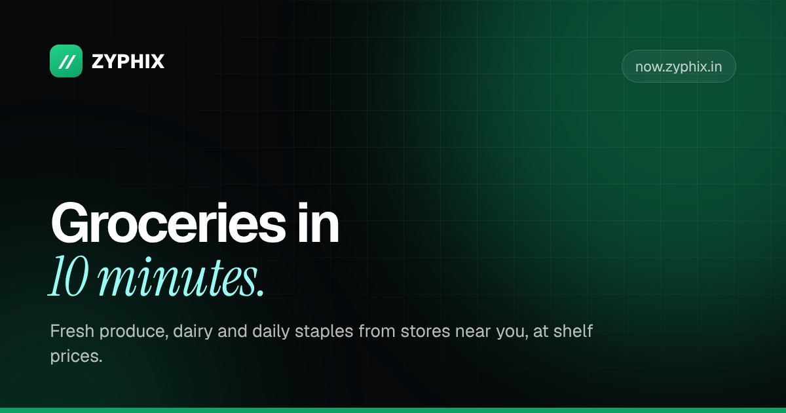</a></td>
    <td width="33%"><a href="https://eats.zyphix.in">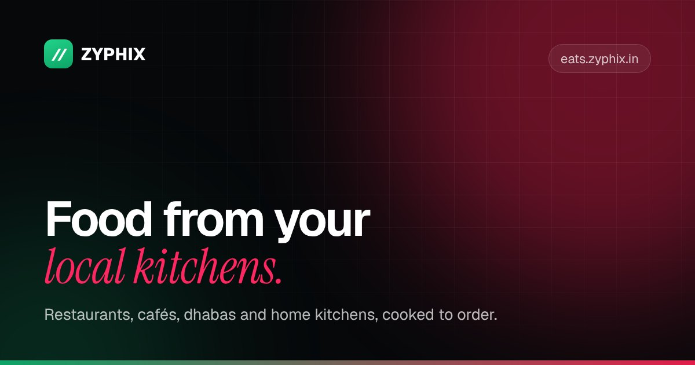</a></td>
    <td width="33%"><a href="https://book.zyphix.in">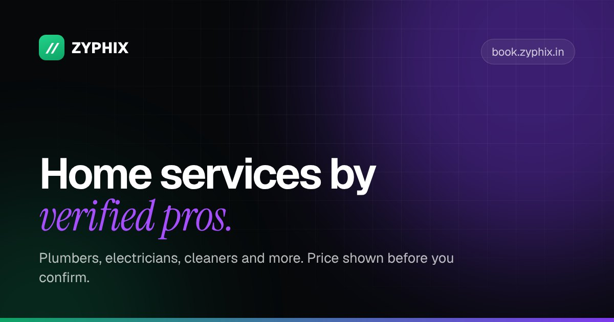</a></td>
  </tr>
  <tr>
    <td><b>Zyphix Now</b><br /><sub>Groceries and daily essentials from nearby stores, delivered in about 30 minutes at shelf prices.</sub></td>
    <td><b>Zyphix Eats</b><br /><sub>Restaurants, cafés, dhabas and home kitchens near you, cooked to order.</sub></td>
    <td><b>Zyphix Book</b><br /><sub>Plumbers, electricians, cleaners and more. Verified pros, price shown before you confirm.</sub></td>
  </tr>
  <tr>
    <td><a href="https://partner.zyphix.in">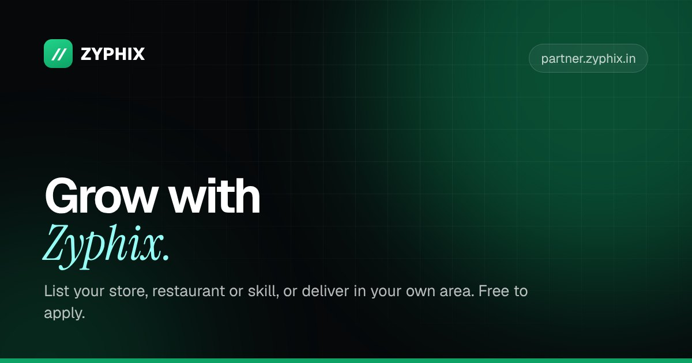</a></td>
    <td><a href="https://advertise.zyphix.in">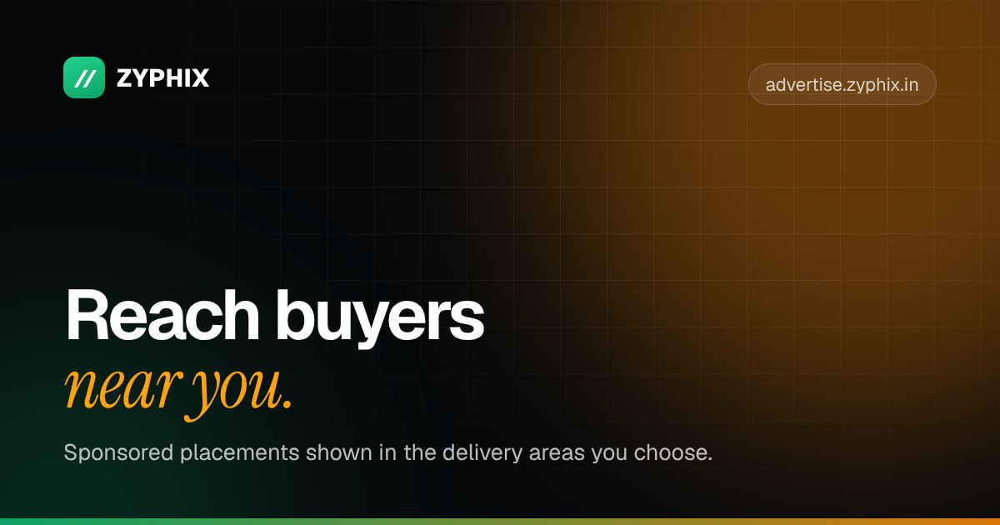</a></td>
    <td><a href="https://support.zyphix.in">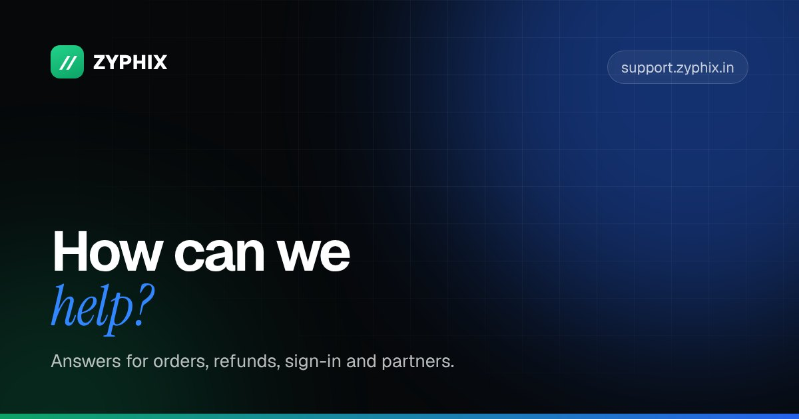</a></td>
  </tr>
  <tr>
    <td><b>Partners</b><br /><sub>Onboarding for stores, restaurants, professionals and delivery partners. Free to apply.</sub></td>
    <td><b>Advertise</b><br /><sub>Sponsored placements shown to buyers in the delivery areas you choose.</sub></td>
    <td><b>Support</b><br /><sub>Help centre for orders, refunds, sign-in and partners, with a real person behind it.</sub></td>
  </tr>
</table>

<br />

## See it in action

<div align="center">
  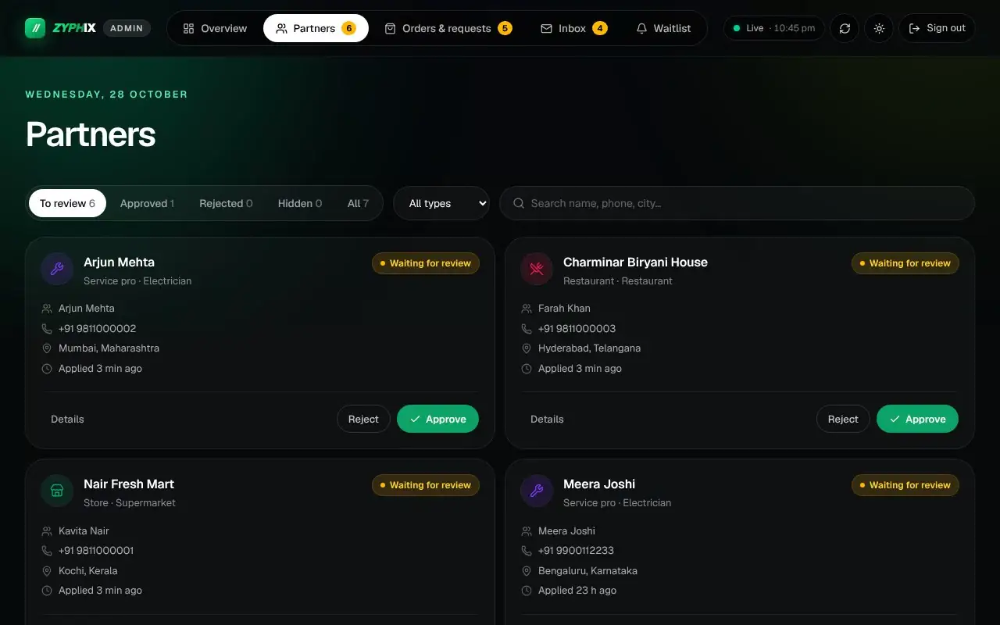
  <p><sub>The operations console at <code>admin.zyphix.in</code>: a new partner application arrives live, is reviewed and published in one click. <a href="docs/readme/admin-live.mp4">Watch as MP4</a> · sample data</sub></p>
</div>

<table>
  <tr>
    <td width="50%">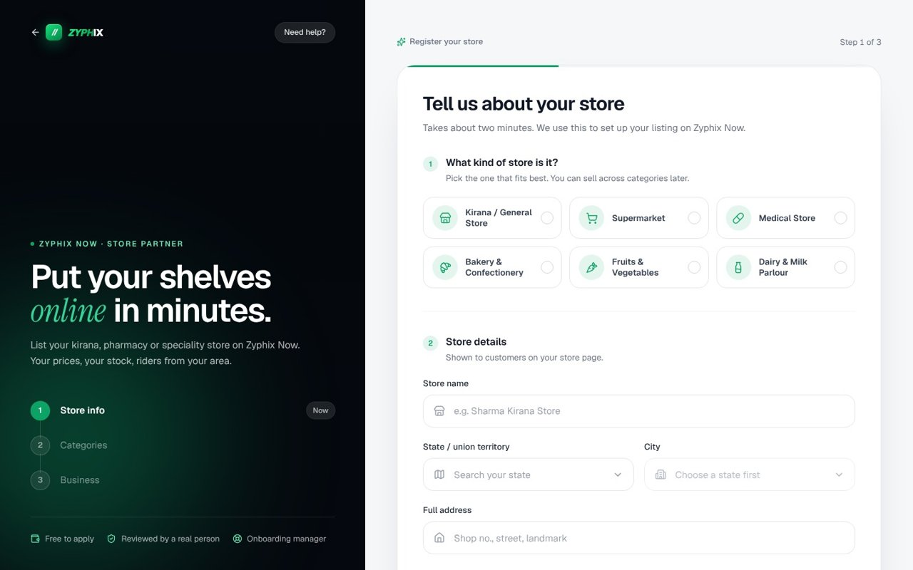</td>
    <td width="50%">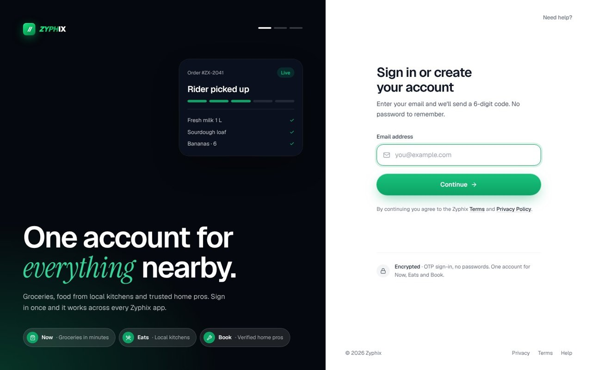</td>
  </tr>
  <tr>
    <td><b>Partner registration</b><br /><sub>Guided, step-by-step applications for every partner type, with a PDF copy emailed on submit.</sub></td>
    <td><b>One sign-in for every product</b><br /><sub>Passwordless email codes at <code>auth.zyphix.in</code>; the session is shared across all subdomains.</sub></td>
  </tr>
  <tr>
    <td>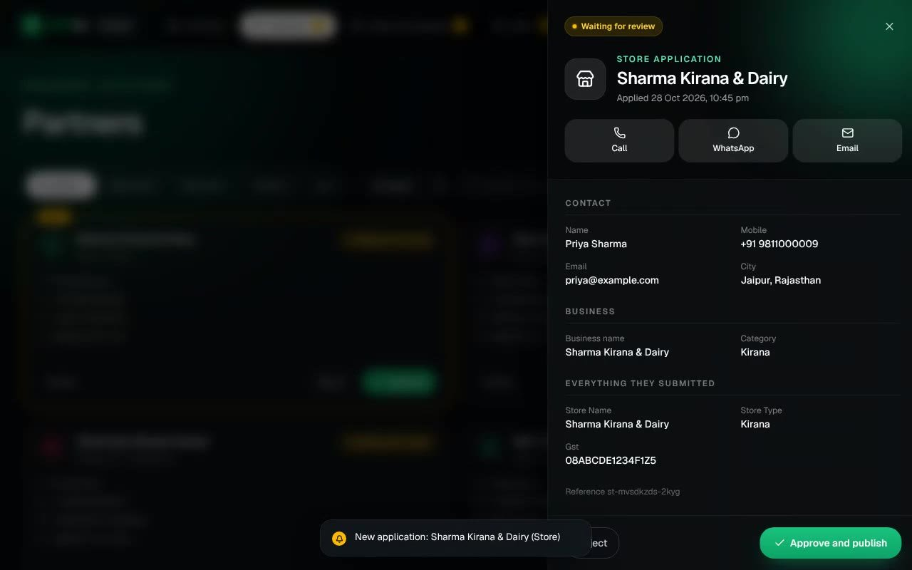</td>
    <td>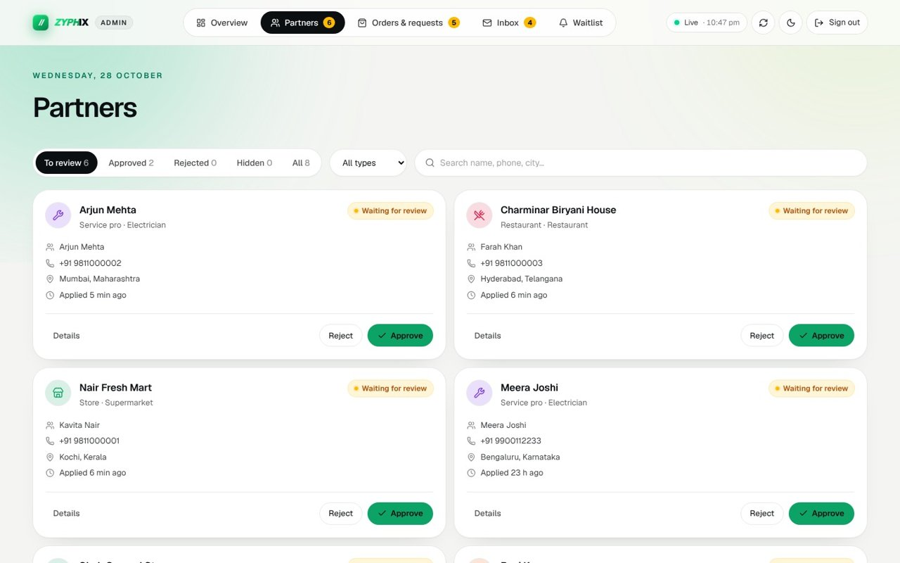</td>
  </tr>
  <tr>
    <td><b>Review with full context</b><br /><sub>Every submitted detail, with call, WhatsApp and email actions.</sub></td>
    <td><b>Dark and light themes</b><br /><sub>The console auto-refreshes and flags new applications as they arrive.</sub></td>
  </tr>
</table>

<br />

## What's inside

| | |
| --- | --- |
| **One codebase, every subdomain** | A single React app detects the host and renders the right product: Now, Eats, Book, Partners, Advertise, Support, Auth, Accounts and Admin. |
| **Edge-rendered SEO** | Unique titles, descriptions, canonicals, Open Graph tags and structured data are written into each page at the edge. Per-host `robots.txt` and sitemaps, 301 redirects and real 404s. |
| **Passwordless accounts** | Six-digit email codes, hashed in D1, expire in ten minutes and are rate-limited. One session cookie for `*.zyphix.in`. |
| **Partner pipeline** | Applications land as *pending*; the console approves, rejects or hides them. Applicants and the team get an email with a PDF of the application. |
| **Self-filling catalog** | A scheduled Worker resolves product photos, generates produce imagery with Workers AI and builds WebP thumbnails in R2. |
| **Protection built in** | HSTS, CSP baseline and frame protection on every response, rate limits and spam traps on public forms, admin lockout after repeated failed keys. |
| **Cinematic, but fast** | Video heroes, film-open letterboxing and motion throughout, with a service worker, lazy media and reduced-motion support. |

<br />

## Architecture

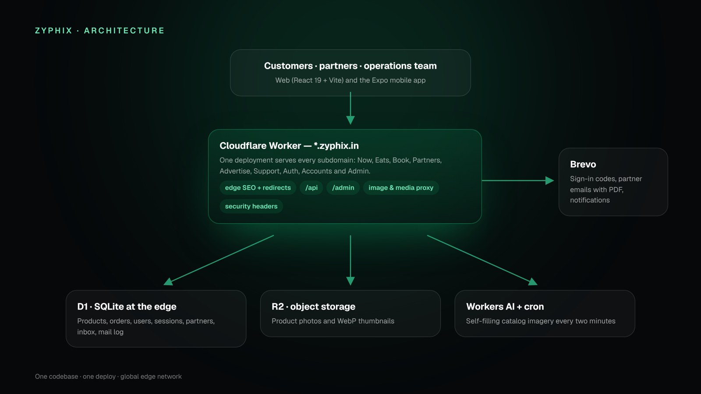

| Layer | Technology |
| --- | --- |
| Frontend | React 19, Vite 7, TypeScript, Tailwind CSS v4, wouter, Framer Motion |
| Edge and API | Cloudflare Workers, HTMLRewriter, static assets |
| Data | Cloudflare D1, R2, Workers AI |
| Email | Brevo transactional API, PDFs generated with pdf-lib |
| Mobile | Expo / React Native |
| Tooling | pnpm workspaces, Wrangler, Playwright |

<details>
<summary><b>Repository layout</b></summary>

```text
Zyphix/
├── artifacts/zyphix/       # web app + Cloudflare Worker (what gets deployed)
│   ├── src/                # React app: pages, sites (partner, support, auth…), UI kit
│   ├── worker/             # Worker: API, edge layer, email + PDF
│   ├── shared/             # page map shared by the Worker and the app (SEO, sitemaps)
│   ├── public/             # fonts, images, Open Graph images, service worker
│   ├── db/                 # D1 schema and seed data
│   ├── scripts/            # build, catalog and image pipeline scripts
│   ├── wrangler.toml       # Worker configuration and bindings
│   └── DEPLOY.md           # first-time Cloudflare setup
├── mobile/                 # Expo app for Android and iOS
├── lib/                    # shared workspace libraries
└── docs/readme/         # media used in this README
```

</details>

<br />

## Getting started

**Requirements:** Node.js 20+, pnpm 10, and a Cloudflare account (`pnpm exec wrangler login`).

```bash
git clone https://github.com/sangralrahul/Zyphix.git
cd Zyphix && pnpm install

cd artifacts/zyphix
pnpm run dev        # front-end only (Vite)
pnpm run cf:dev     # full stack: Worker with local D1 and R2
```

Preview any subdomain locally by adding `?site=now`, `eats`, `book`, `partner`, `advertise`, `support`, `auth`, `accounts` or `admin` to the URL.

<details>
<summary><b>Configuration</b></summary>

Secrets live on the Worker and are never committed:

```bash
pnpm exec wrangler secret put ADMIN_TOKEN
pnpm exec wrangler secret put BREVO_API_KEY
```

| Variable | Required | Purpose |
| --- | --- | --- |
| `ADMIN_TOKEN` | Yes | Key for the operations console and `/admin/*` |
| `BREVO_API_KEY` | Yes | Sign-in codes, partner and contact emails |
| `MAIL_FROM` | No | Default sender, `noreply@zyphix.in` |
| `PARTNER_FROM` | No | Partner email sender, `partnerships@zyphix.in` |
| `PARTNER_NOTIFY_EMAIL` | No | Who is told about new partner applications |
| `NOTIFY_EMAIL` | No | Who receives contact, support and advertiser messages |

For local development, put the same keys in `artifacts/zyphix/.dev.vars` (ignored by git).

</details>

<details>
<summary><b>Deployment and scripts</b></summary>

```bash
cd artifacts/zyphix
pnpm run cf:deploy  # build and deploy the Worker with its assets
```

Each subdomain is attached to the `zyphix` Worker as a custom domain (Workers & Pages → zyphix → Settings → Domains & Routes). First-time D1, R2 and catalog setup is in [`artifacts/zyphix/DEPLOY.md`](artifacts/zyphix/DEPLOY.md).

| Command | Description |
| --- | --- |
| `pnpm run dev` | Vite dev server |
| `pnpm run build:cf` | Production build for Cloudflare |
| `pnpm run cf:dev` | Build and run the Worker locally |
| `pnpm run cf:deploy` | Build and deploy |
| `pnpm run typecheck` | Type-check the app |
| `pnpm run db:schema` / `db:seed` | Create and seed the remote D1 database |
| `pnpm run images:sync` | Resolve missing product images |

</details>

<br />

## Security

Please don't report vulnerabilities in public issues. Email **security@zyphix.in**, or see [`/.well-known/security.txt`](https://zyphix.in/.well-known/security.txt).

<br />

<div align="center">
  <a href="https://zyphix.in"></a>
  <p><b>Zyphix</b> is a product of <a href="https://clavix.in">Clavix Technologies Pvt. Ltd.</a></p>
  <sub>© 2026 Clavix Technologies Pvt. Ltd. All rights reserved. · <a href="https://zyphix.in/privacy">Privacy</a> · <a href="https://zyphix.in/terms">Terms</a></sub>
</div>
